# RoverLink

**Бортовая станция связи, видео и управления для трёх НРТК: Богомол B5,
Антилопа 4×4 и ТП-34.** Одноплатный компьютер стоит на машине и связывает
пост оператора с её системой управления. Оператор работает с Mission Planner,
пультом и видеопотоком; настройка станции выполняется через веб-панель.

Поддерживаются Raspberry Pi 4, Raspberry Pi 5, Radxa ROCK 5C и Orange Pi 5.
Доступные режимы, камеры и способы кодирования зависят от платы и сборки.

[Платформы](#платформы-и-режимы) · [Возможности](#возможности) ·
[Железо](#железо-и-комплект) · [Перед выездом](#проверка-перед-выездом) ·
[Документация](#документация) · [Сайт](https://hauger-it.com/roverlink/)

## Платформы и режимы

Три машины используют четыре режима. Режим определяет подключение и
поведение при потере команд: настройки одной машины нельзя переносить
на другую без проверки.

| Платформа и режим | Роль RoverLink | Кто отвечает за потерю команд |
|---|---|---|
| Богомол B5 без полётного контроллера | Виртуальный борт для Mission Planner, передача каналов по CRSF в штатную систему машины | RoverLink, профиль failsafe этого режима |
| Богомол B5 с полётным контроллером | Прозрачный мост Mission Planner ↔ USB ↔ полётный контроллер | Прошивка полётного контроллера |
| Антилопа 4×4 | Интеграция со штатной платой вместо радиомодуля, приём телеметрии машины | Отдельная логика режима Антилопы |
| ТП-34 | Виртуальный борт для Mission Planner, подключение штатной платы без отдельного полётного контроллера | Отдельный профиль режима ТП-34 |

### Богомол B5

Вариант **без полётного контроллера** принимает команды от Mission Planner
и передаёт их машине по CRSF. Пульт или джойстик подключён к компьютеру
оператора. Панель отдельно показывает наличие сетевого соединения и поступление
каналов: подключённый Mission Planner ещё не означает, что управление включено.

Вариант **с полётным контроллером** передаёт MAVLink в обе стороны через USB.
Параметры, миссии и калибровки проходят к контроллеру; станция не создаёт
собственный борт и не вмешивается в failsafe. Предусмотрены поиск контроллера,
подбор скорости порта и восстановление соединения после обрыва USB.

Исторический SBUS-выход существует в ядре, но скрыт из панели. Это не общий
выход для всех машин и не основание подключать его к Антилопе или ТП-34.

### Антилопа 4×4

Колёсная платформа с поворотом разницей мощности бортов. RoverLink работает
со штатной платой управления; полётный контроллер и CRSF-мост не используются.
Публичное описание ограничено возможностями оператора, без деталей протокола машины.

- Движение вперёд и назад, поворот и разворот на месте.
- Настраиваемое ограничение мощности, управление зажиганием и тормозами.
- Раздельные экстренное торможение и стояночный тормоз.
- Контроль условий разрешения движения и остановка при потере команд.
- Телеметрия оборотов, напряжения, направления вращения и заряда батареи;
  передача заряда в HUD Mission Planner при подключённой телеметрии.
- Управление рядом с машиной с геймпада: удержание «мёртвой руки»,
  контроль поступления событий и повторный взвод после обрыва связи.

Проверять нужно и движение, и торможение под нагрузкой: вращение колёс
на подставке не подтверждает поведение машины на грунте.

### ТП-34

Станция подключается к штатной плате ТП-34 без отдельного полётного контроллера.
Пульт работает через Mission Planner. Для потери команд предусмотрен
собственный профиль остановки; настройки failsafe Богомола не применяются.

**Испытания ТП-34 прошли успешно.**
Специализированная ветка дополнительно развивает многокамерное видео:
дневную камеру, тепловизор и заднюю камеру, выбор пары источников,
перестановку большого и малого изображения. Возможности этой сборки
не означают их автоматическую доступность на других платформах.

[Машины и варианты подключения](docs/machines.md) ·
[Четыре режима](docs/modes.md) · [ТП-34 и видеомикшер](docs/tp34.md)

## Возможности

### Управление и наблюдение

- Mission Planner по сети; выбор и настройка пульта на компьютере оператора.
- Статусы соединения и свежих команд, индикация каналов в применимых режимах.
- Настройки управления и потери связи с учётом конкретной машины.
- Локальный геймпад с «мёртвой рукой» в поддерживающих его сборках.
  Сторож тишины учитывает не только отключение Bluetooth, но и прекращение событий.
- Веб-панель для настройки станции и просмотра диагностики.

### Видео

USB-камера или плата захвата и сетевой RTSP-источник подключаются согласно
комплектации. Видеопоток можно смотреть в совместимом клиенте, включая
Mission Planner с настроенным видеокомпонентом. В поддерживаемых сборках
доступны выбор разрешения, частоты кадров и битрейта, наложение текста,
автозапуск потока и индикация отсутствия источника.

Проброс RTSP без перекодирования позволяет снизить нагрузку; наложение текста,
поворот и смешивание изображений могут требовать обработки. Задержка зависит
от камеры, кодирования, плеера и сети — нулевая задержка не обещается.

Для USB-захвата формат выбирается с учётом возможностей устройства и пропускной
способности шины. Pi 4 поддерживает аппаратное H.264 при подходящем ядре и
драйвере. В специализированном видеотракте ROCK 5C используется аппаратное
H.264/H.265. Эти возможности нельзя переносить на все платы и версии одинаково.

### Сеть и работа в поле

- Ethernet, локальная Wi-Fi-сеть или меш как канал между постом и машиной.
- DHCP и статические адреса из панели; подтверждение изменения сети
  и возврат прежних настроек при отсутствии подтверждения.
- Сканер подсетей и диагностика меш-модема в поддерживаемой комплектации.
- Wi-Fi-точка доступа станции, если она включена в выбранной сборке.
- Удалённая связь через ZeroTier при наличии интернета. Starlink может служить
  интернет-каналом, но не заменяет настройки доступа и проверку качества связи.
- Локальная панель работает без внешних CDN. Для установки без интернета
  зависимости и комплект поставки подготавливаются заранее.

Индикатор качества связи помогает различать доступность управления и передачу
крупных пакетов: работающий Mission Planner не гарантирует устойчивого видео.

### Диагностика и обслуживание

Панель показывает нагрузку CPU, память, температуру и доступные сведения
о вентиляторе. Данные питания зависят от датчиков платы; функции управления
USB — от сборки и оборудования. Настройки сохраняются между запусками.
Диагностический «чёрный ящик» предусмотрен в новых поставках для разбора
состояния системы, сети и видеотракта; его наличие проверяется по комплекту.

Наработки линии 2.6 сохранены в описании возможностей: сторож геймпада,
индикатор качества связи, диагностика питания и USB, выбор формата захвата
и учёт различий драйверов геймпада. Это история развития, а не номер новой сборки.

## Железо и комплект

| Компонент | Назначение и ограничения |
|---|---|
| Raspberry Pi 4 | Бортовая станция; аппаратное H.264 зависит от ядра и драйвера |
| Raspberry Pi 5 | Бортовая станция; питание USB и охлаждение проверяются с комплектом камер |
| Radxa ROCK 5C | Бортовая станция; аппаратный видеотракт требует подходящих сборки, драйверов и ОС |
| Orange Pi 5 | Поддержка в линии ТП-34; отдельная схема UART и аппаратный видеотракт |
| Штатная плата машины или полётный контроллер | Подключение и режим выбираются по платформе |
| Пульт или HID-джойстик | Подключается к компьютеру оператора для работы через Mission Planner |
| Геймпад | Локальное управление рядом с машиной в поддерживаемом режиме |
| USB-камера, USB-захват или RTSP-камера | Кодек, питание и режим захвата проверяются отдельно |
| Ethernet/Wi-Fi/меш | Пропускная способность должна соответствовать выбранному видео |
| Питание, охлаждение, антенны и кабели | Подбираются под плату, камеры и условия машины |

Используйте схему подключения для конкретных машины, платы и поставки.
USB-подключение полётного контроллера и UART-подключение штатной платы —
разные варианты. Совместимость со всеми камерами, адаптерами и образами Linux
не заявляется.

Для установки запрашивается комплект под конкретную платформу. Этот репозиторий
содержит публичную документацию; установщика и рабочих исходников станции здесь нет.

## Новое и статус версий

- **ТП-34 добавлен к Богомолу B5 и Антилопе.** Испытания прошли успешно; ТП-34 остаётся одной из трёх поддерживаемых платформ.
- **Линия ТП-34: 3.3-tp34-beta15.** Работоспособность подтверждена владельцем
  проекта 11 ноября 2026 года. Добавлены полноэкранные виды «Только день»,
  «Только ночь» и «Только зад», отдельная схема подключения Orange Pi 5,
  WebRTC/WHEP и разделение настроек входной камеры и выходного кодера.
  Это специализированная бета ТП-34; номер не означает общий релиз для всех машин.
- **RoverLink НСУ** развивается отдельно от бортовой станции.

Сборку выбирают по машине и комплекту оборудования. Успешный выезд ТП-34
не является подтверждением испытаний каждой последующей бета-функции.

## RoverLink НСУ

Актуальная версия — **1.3.0**, отдельное приложение оператора для Windows.
Поддерживает DirectInput, передачу управления по MAVLink v2, переключение
камер и единое подключение к станции. Интерфейс обновлён.

11 ноября 2026 года владелец проекта подтвердил проверку этой версии
на рабочей машине в поле. Это подтверждение проверенной комплектации;
совместимость с другим оборудованием проверяется отдельно.
Версия НСУ не является версией прошивки станции.

[Возможности и ограничения НСУ](docs/nsu.md) · [Страница НСУ](https://hauger-it.com/nsu/)

## Проверка перед выездом

1. Сверьте машину, режим, плату и сборку. Подготовьте безопасное место,
   исключите людей из зоны движения и обеспечьте возможность остановки.
2. Проверьте крепление, питание, кабели, антенны и изображение каждой камеры.
   Отдельно проверьте питание и видео при работе приводов.
3. В безопасных условиях проверьте нейтраль, направление осей, назначение
   переключателей, ограничение мощности и реакцию каждого тормоза.
4. Проверьте потерю команд отключением источника. Для Богомола
   без полётного контроллера проверяется failsafe станции; с контроллером —
   его прошивка. Для Антилопы и ТП-34 используются собственные профили режима.
5. Проверьте возврат связи и условия возобновления управления. Для геймпада —
   отпускание «мёртвой руки», отключение и повторное подключение.
6. Убедитесь, что активен нужный пост управления. Соединение
   с Mission Planner не заменяет проверку поступления команд.
7. Смените стандартные пароли, ограничьте доступ к панели и проверьте,
   кто допущен в удалённую сеть. Не публикуйте конфигурации, ключи,
   адреса, координаты и неочищенные журналы.

[Поведение при потере команд](docs/failsafe.md) · [Настройка Mission Planner](docs/mission-planner.md)

## Документация

| Раздел | Что читать |
|---|---|
| Машины | [Богомол B5, Антилопа 4×4, ТП-34](docs/machines.md) |
| Выбор режима | [Четыре режима и границы ответственности](docs/modes.md) |
| Пост оператора | [Подключение Mission Planner](docs/mission-planner.md) |
| Потеря команд | [Failsafe по режимам и проверка](docs/failsafe.md) |
| Сеть | [Адреса, интерфейсы и подтверждение изменений](docs/network.md) |
| ТП-34 | [Платформа и специализированное видео](docs/tp34.md) |
| НСУ | [Приложение оператора, версия и статус проверок](docs/nsu.md) |

Краткие сведения о видео, геймпаде, диагностике, установке и оборудовании
приведены выше. Подробную инструкцию выбирают по установленной сборке.
Исторические скриншоты и видеомануалы не включены в эту подборку.

## Доступ и обратная связь

Это публичная витрина: описание проекта и пользовательская документация.
Исходники разработки и рабочие комплекты поставляются отдельно.
Свободное ядро — [GPL-3.0](LICENSE); условия коммерческой ветки —
[LICENSE-COMMERCIAL.md](LICENSE-COMMERCIAL.md).

В [Issues](https://github.com/xaker-enginer/roverlink/issues) можно сообщить
об ошибке документации или предложить улучшение. Укажите платформу, плату,
версию и наблюдаемое поведение; прикладывайте только очищенные материалы.

Автор — **Дмитрий Прокофьев (XAKER)**, проект **HAUGER IT**.
[hauger-it.com](https://hauger-it.com/) · [Связаться по поводу комплекта и доступа](mailto:dmitry@hauger-it.com)
